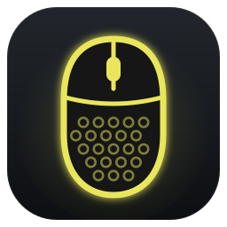
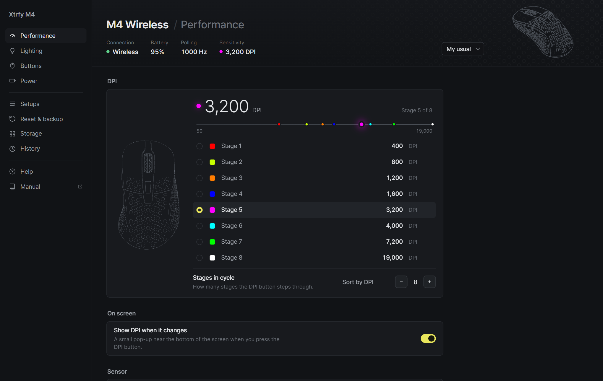
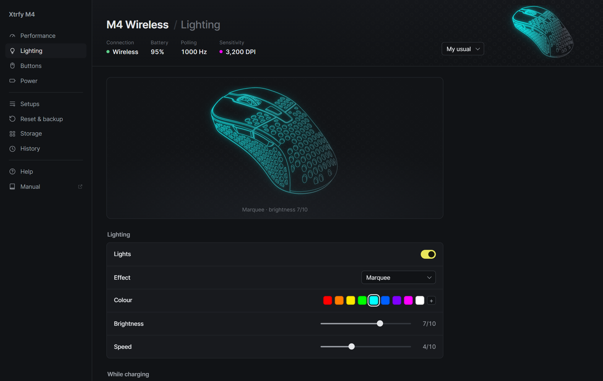
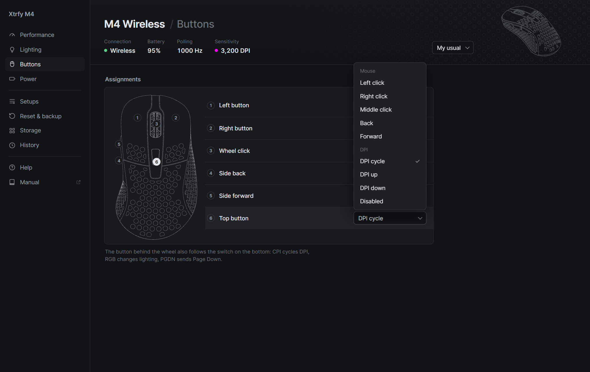
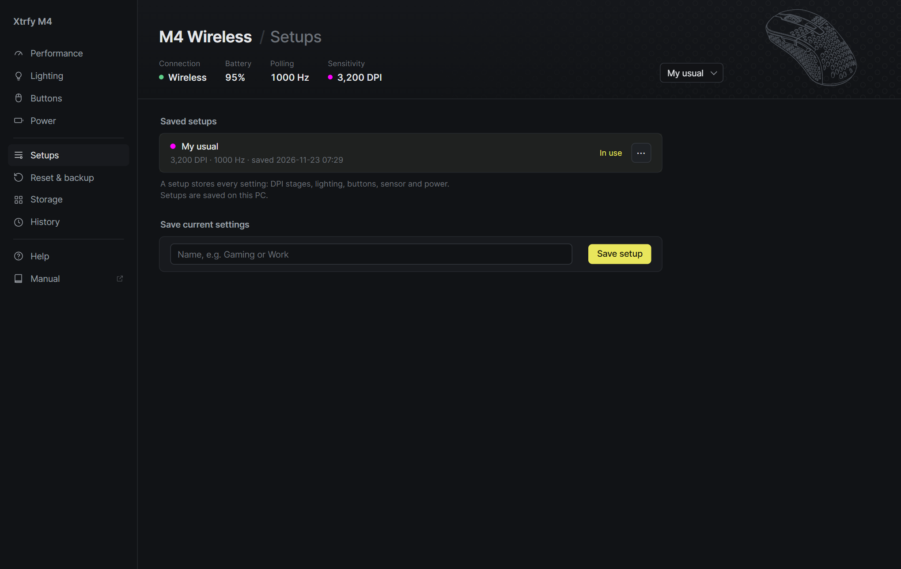
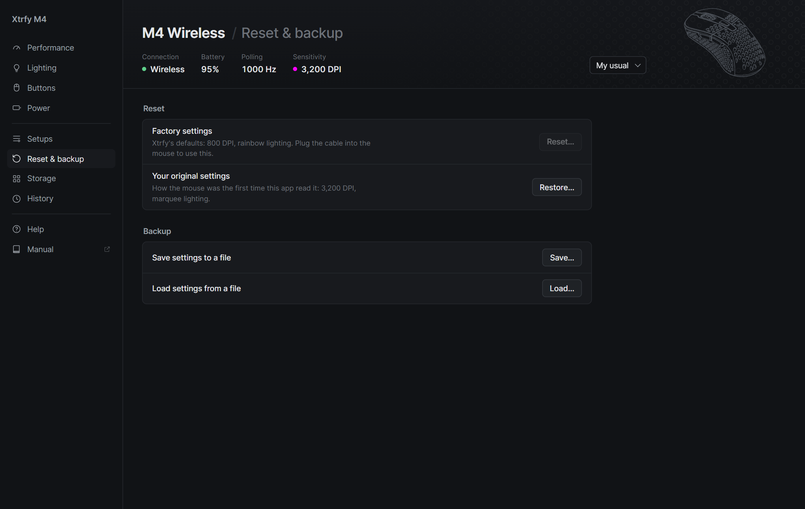
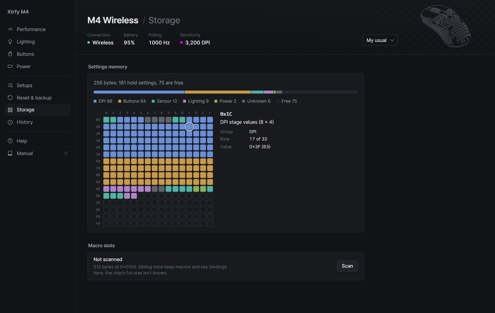
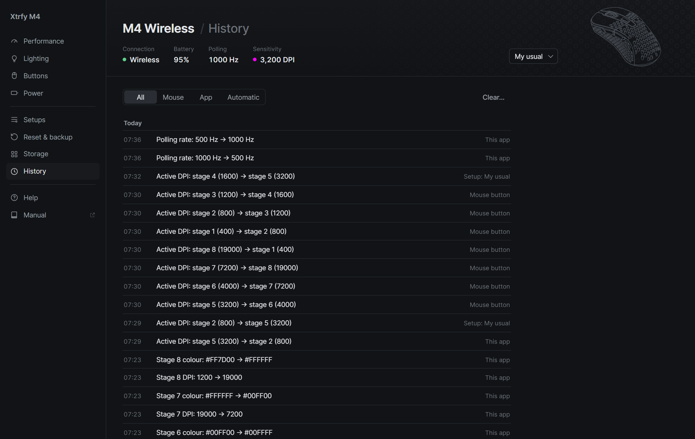
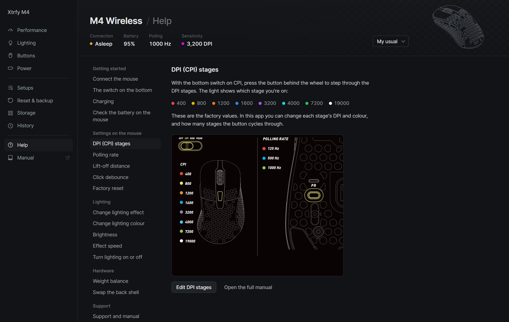

<p align="center">
  
</p>

<h1 align="center">Xtrfy M4 Control</h1>

<p align="center">
  An unofficial settings app for the <strong>Xtrfy M4 Wireless</strong>, a mouse that ships without any software.
</p>

<p align="center">
  
</p>

## The problem

The Xtrfy M4 Wireless has no companion software. Xtrfy chose to put every setting on the mouse itself: you hold button combinations for three or five seconds and read the result from a coloured light, using a 12-page picture guide as the key.

That works, but it leaves a lot out of reach:

- You can't see what the mouse is currently set to. "Purple" means 3200 DPI only if you remember the table.
- DPI is limited to the eight factory values. Changing them, or how many stages the DPI button cycles through, isn't possible on the mouse.
- Buttons can't be remapped.
- There's no battery percentage, only four colour bands.
- Debounce is limited to 2, 4, 8 or 12 ms, and polling rate to 125, 500 or 1000 Hz.
- Nothing can be saved, restored or switched between.

The mouse's firmware supports all of this. Only the software was missing, so this project provides it.

## What it does

**Performance**
- Edit all 8 DPI stages, from 50 to 19,000 DPI, and choose each stage's indicator colour
- Pick the active stage, set how many stages the DPI button cycles through, remove stages, sort them by DPI
- Polling rate (125, 250, 500, 1000 Hz), lift-off distance (1 or 2 mm), click debounce (0–30 ms)
- Angle snapping, ripple control, motion sync
- An on-screen pop-up showing the new DPI when you press the DPI button

**Lighting**
- Turn the lights on or off, choose the effect, colour, brightness and speed
- A live preview that draws the mouse lit with your actual effect
- **Hide the charging blink**: with the lights off, the mouse blinks while it charges. This option shows a faint steady glow instead and goes dark again once the mouse is full or unplugged

**Buttons**
- Assign each of the six buttons: left, right, middle, back, forward, DPI cycle, DPI up, DPI down, or disabled
- The app warns you before saving a layout with no left click

**Setups, reset and backup**
- Save named setups (for example *Gaming* and *Work*) and switch between them from any page
- Restore Xtrfy's factory settings, or the exact settings your mouse had the first time the app read it
- Save all settings to a file and load them back

**Insight**
- Battery percentage and charging state
- History of every change, whether it came from the app, the mouse's own buttons, or something done while the app was closed
- A storage view showing all 256 bytes of the mouse's settings memory, and what each one holds
- Help pages based on Xtrfy's quick-start guide, with a link to the full guide

**Behaviour**
- Changes save straight to the mouse; there's no Save button
- Works over the wireless receiver or the USB cable, and switches automatically when you plug the cable in or out
- When the mouse falls asleep, its settings stay on screen. Changes you make are kept and sent as soon as you move it
- An optional background helper starts with Windows, so automatic lighting, the DPI pop-up and History keep working with the window closed

## Screenshots

| | |
|---|---|
|  |  |
| **Lighting.** The preview shows the selected effect, colour, brightness and speed. | **Buttons.** Numbered markers on the drawing match the list. |
|  |  |
| **Setups.** Save the current settings and switch with one click. | **Reset & backup.** Factory settings, your original settings, or a file. |
|  |  |
| **Storage.** Point at any byte to see what it holds. | **History.** Each change, when it happened, and where it came from. |
|  |  |
| **Help.** Built from the quick-start guide. | **DPI pop-up.** Appears when you press the DPI button. |

## Requirements

- Windows 10 or 11
- Python 3.10 or newer (developed on 3.13)
- [pywebview](https://pywebview.flowrl.com/) for the app window. It uses the WebView2 runtime, which ships with Windows 11 and current Windows 10
- An Xtrfy M4 Wireless, through its receiver (USB ID `25A7:FA99`) or the cable (`25A7:FA92`)

Tested with mouse firmware **V3.18**, the latest Xtrfy has published (July 2022). Receiver revision `13.34`.

## Getting started

```powershell
git clone https://github.com/Xurify/xtrfy-m4-control-software.git
cd xtrfy-m4-control-software
python -m pip install -r requirements.txt
```

Then double-click **`Xtrfy M4.bat`**, or run `pythonw xtrfy_m4.pyw`. The first launch adds an **Xtrfy M4** entry to the Start menu.

To keep the background features running, turn on **Power → Run in the background**. This adds a shortcut to your Startup folder; turning it off removes it. No administrator rights are needed.

The mouse talks to the app through standard Windows HID drivers, so no driver install is involved. Xtrfy's firmware updater and this app shouldn't run at the same time, because both send commands to the mouse.

## How it works

```
┌──────────────────────┐     HTTP + SSE      ┌────────────────────────────┐   HID feature/input reports   ┌────────────┐
│ App window           │ ──────────────────▶ │ Background helper          │ ────────────────────────────▶ │ Receiver   │ ─ 2.4 GHz ─▶ M4
│ pywebview / WebView2 │ ◀────────────────── │ server.py on 127.0.0.1     │ ◀──────────────────────────── │ or cable   │
│ web/ (HTML, CSS, JS) │   live state        │ owns the HID connection    │                               └────────────┘
└──────────────────────┘                     └────────────────────────────┘
```

- **`xtrfy_m4_helper.pyw`** runs the backend: a small HTTP server bound to `127.0.0.1:47813`. Only this process talks to the mouse, and one lock serialises all traffic so the poller and requests never interleave. It polls about three times a second for button events and checks every 3 s whether the mouse is awake.
- **`xtrfy_m4.pyw`** opens the window, starting the helper first if it isn't already running. Closing the window leaves the helper running.
- **The web UI** gets the full state pushed over Server-Sent Events and sends changes as small JSON patches. The server applies a patch to a copy of the mouse's memory and writes only the 10-byte chunks that changed.
- **Security:** the server checks the `Host` header, to block DNS rebinding, and requires a random token generated at each start. A website open in your browser can't reach the mouse through it.
- **HID access** uses `ctypes` with Windows' own `hid.dll` and `setupapi.dll`. No third-party HID library is involved.

## Protocol notes

The M4 Wireless uses a Compx chipset (USB vendor ID `25A7`). Other Compx-based mice use a closely related protocol; see [Credits](#credits). Everything below was verified on a real M4 Wireless.

**Transport.** Interface 1 exposes vendor collections. Commands are sent as a 17-byte **feature report `0x08`** (usage page `FF02`). Replies arrive as a 17-byte **input report `0x09`** (`FF01`), and so do unsolicited events.

```
byte  0     1        2       3       4       5     6..15   16
      0x08  opcode   status  addr_hi addr_lo len   data    checksum = (0x55 − sum(bytes 0..15)) & 0xFF
```

| Opcode | Meaning |
|---|---|
| `0x03` | Is the mouse connected to the receiver (`data[0] == 1`) |
| `0x04` | Battery: `data[0]` = percent, `data[1]` = charging |
| `0x07` | Write up to 10 bytes of settings memory |
| `0x08` | Read up to 10 bytes of settings memory |
| `0x09` | Factory reset. Over the cable it keeps the receiver pairing |
| `0x0A` | Event from the mouse: `data[0] = 1` means a DPI change, `data[1]` is the new stage |

**Settings memory** (`0x00`–`0xB4`). Most values are stored as a pair, `value, 0x55 − value`.

| Address | Setting | Encoding |
|---|---|---|
| `0x00` | Polling rate | `1`=1000, `2`=500, `4`=250, `8`=125 Hz |
| `0x02` | Stages in cycle | 1–8 |
| `0x04` | Active stage | 0-based |
| `0x0A` | Lift-off distance | `1`=1 mm, `2`=2 mm |
| `0x0C` | DPI stages, 8 × 4 bytes | `[x, y, flags, check]`. Up to 10,000 DPI: `dpi/50 − 1`, flags `0x00`. Above that: `dpi/100 − 1`, flags `0x22` |
| `0x2C` | Stage colours, 8 × 4 bytes | `[R, G, B, check]` |
| `0x4C` | Indicator settings, 20 bytes | Not decoded |
| `0x60` | Buttons, 16 × 4 bytes | `[type, a, b, check]`. Mouse button `01 mask`, DPI `02 1/2/3`, disabled `00` |
| `0xA0` | Lighting, 7 bytes | `[effect, R, G, B, speed, brightness, check]`. Effects: `0` spectrum, `1` breathing, `2` static, `3` neon, `4` off, `5` marquee, `7` colour breathing |
| `0xA9` | Debounce | ms |
| `0xAB` | Motion sync | 0/1 |
| `0xAD` | Sleep timer | units of 10 s |
| `0xAF` | Angle snapping | 0/1 |
| `0xB1` | Ripple control | 0/1 |
| `0xB5`–`0xFF` | Unused | Writable, and survives a power cycle |

**Things worth knowing**
- The charging blink comes from the firmware. No setting in this memory changes it; we tested every unknown value on the mouse. It is only visible while the lights are off and the mouse is charging, and static lighting at brightness 2 or higher covers it.
- The mouse sleeps after its idle timer (60 s by default). While it sleeps, the receiver still answers, but the mouse's memory can't be read or written.
- With the cable plugged in, the mouse stops answering through the receiver and appears as `25A7:FA92`.
- The USB revision number (`bcdDevice`) is the firmware version: `0318` means V3.18.

## Safety

- The app only writes the settings memory, the same memory the mouse's own button combinations change. It never touches firmware and never enters update mode.
- After every write, it reads the memory back and compares it with what it sent.
- The first time it reads a mouse, it saves an untouched copy, so **Your original settings** can always put it back exactly.
- Factory reset was tested on a real mouse: it restored Xtrfy's defaults and kept the wireless pairing.

## Your data

Everything the app stores is in `%APPDATA%\XtrfyM4`:

| File | Contents |
|---|---|
| `original.m4` | The mouse's settings from the first time the app read it |
| `setups.json` | Saved setups |
| `history.jsonl` | Change history, one JSON object per line |
| `last-seen.m4` | The last settings seen, used to spot changes made while the app was closed and to show settings while the mouse sleeps |
| `prefs.json` | App preferences, such as lights-off state and the DPI pop-up |
| `helper.log` | Errors from the background helper, if any |

Nothing is sent anywhere. The only network request is opening Xtrfy's online manual when you ask for it.

## Project layout

```
xtrfy_m4.pyw          App window launcher (pywebview), icon and Start menu entry
xtrfy_m4_helper.pyw   Background helper: runs the server, owns the mouse
server.py             HTTP API, state, sleep and queue handling, setups, auto lighting
overlay.py            On-screen DPI pop-up (tkinter, click-through)
m4config.py           Settings memory map: parse and encode, plus a small CLI
compx.py              Compx protocol: framing, checksums, transactions
winhid.py             Windows HID access through ctypes
history.py            Change log and last-seen snapshot
web/                  The interface: index.html, app.css, app.js, help.js, assets/
docs/screenshots/     Images used in this README
```

There's also a command-line tool, for scripting or a quick check:

```powershell
python m4config.py show
python m4config.py backup my-mouse.m4
python m4config.py restore my-mouse.m4
```

Stop the background helper before using it, so the two don't send commands at the same time.

## Limitations

- **Windows only.** HID access and the window use Windows APIs.
- **Keyboard keys, media keys and macros on buttons aren't supported yet.** The firmware has them, but their format hasn't been confirmed on the M4.
- **X and Y DPI are always equal**, although the firmware stores them separately.
- **The 20-byte indicator block at `0x4C` is not decoded.**
- **Only tested with one mouse**, on firmware V3.18. The wired M4 RGB, a different product, isn't supported.

## Credits

The protocol work started from three open-source projects for other Compx-based mice, then every detail was checked against a real M4:

- [VitaminDB/ardor-mouse](https://github.com/VitaminDB/ardor-mouse): the closest match, including the PMW3370 settings layout and the lighting tables
- [mateusands/open-m711pro](https://github.com/mateusands/open-m711pro): framing and button records
- [packerlschupfer/pulsar-mouse-linux](https://github.com/packerlschupfer/pulsar-mouse-linux): reply handling and opcode notes

The device drawings and help illustrations are taken from Xtrfy's *M4 Wireless Quick-Start Guide*. They are Xtrfy's work and are used here to explain their product. The interface font is [Inter](https://rsms.me/inter/), under the SIL Open Font License.

## Disclaimer

This is an independent project. It isn't affiliated with, endorsed by or supported by Xtrfy or Cherry. Use it at your own risk. For hardware support, contact Xtrfy.
